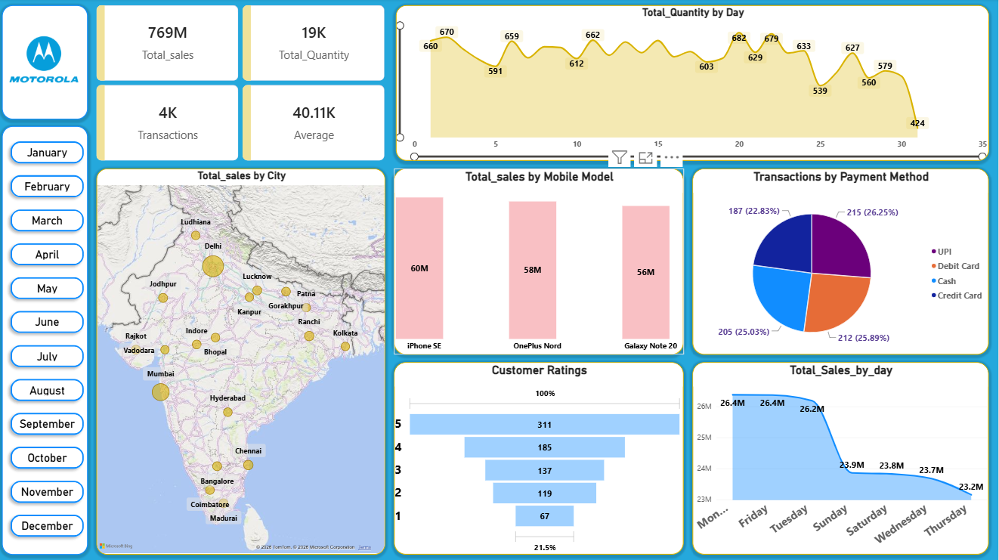

# Mobile Sales Dashboard

I created this project using Power BI to analyze mobile sales data and understand different sales trends.

## Dashboard

## What I worked on

- Cleaned the raw data using Power Query
- Created some measures and calculations in Power BI
- Analyzed total sales, quantity and transactions
- Checked sales by city and mobile model
- Compared different payment methods
- Analyzed customer ratings
- Added filters to make the dashboard interactive

## Tools Used

- Power BI
- Power Query
- Excel

## Data

The project uses raw mobile sales data.  
The data was cleaned and transformed in Power BI before creating the dashboard.

## Project Files

- `sales_powerbi_dashboard.pbix` - Power BI project
- `Raw Sales Data.xlsx` - Raw data
- `Mobile_Sales_dashboard.png` - Dashboard screenshot

## My Learning

This project helped me practice data cleaning, data analysis, creating visuals, using Power Query and building an interactive dashboard in Power BI.